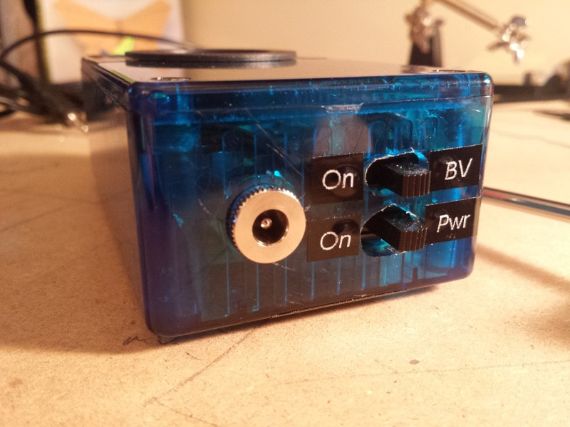
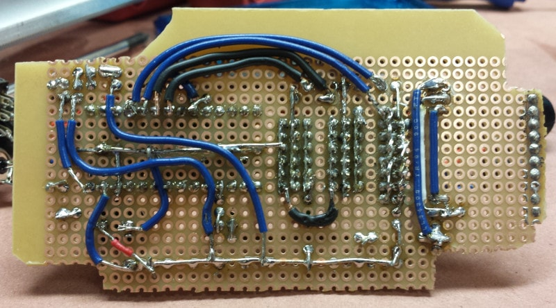

The original Audiolux was a project for an art class. For the upgraded version, I switched to a faster microcontroller (a Teensy) that could run a small real-time FFT onboard. That let it visualize the frequency spectrum of the incoming audio instead of just its amplitude.

Audiolux reads incoming audio as an analog input on the microcontroller, then runs a real-time 1024 point FFT on it. It bins the FFT output logarithmically into 16 bins and assigns each one a color. The result is a hypnotizing audio-synchronized light show.

Two longer strips act as bass visualizers: a pulse of light shoots down them whenever the lowest FFT bin passes a set threshold.

<figure class="fig" data-caption="Audiolux in action"><iframe src="https://www.youtube-nocookie.com/embed/jn_87JqG4mw" title="Audiolux in action" loading="lazy" allow="accelerometer; encrypted-media; gyroscope; picture-in-picture" allowfullscreen></iframe></figure>
