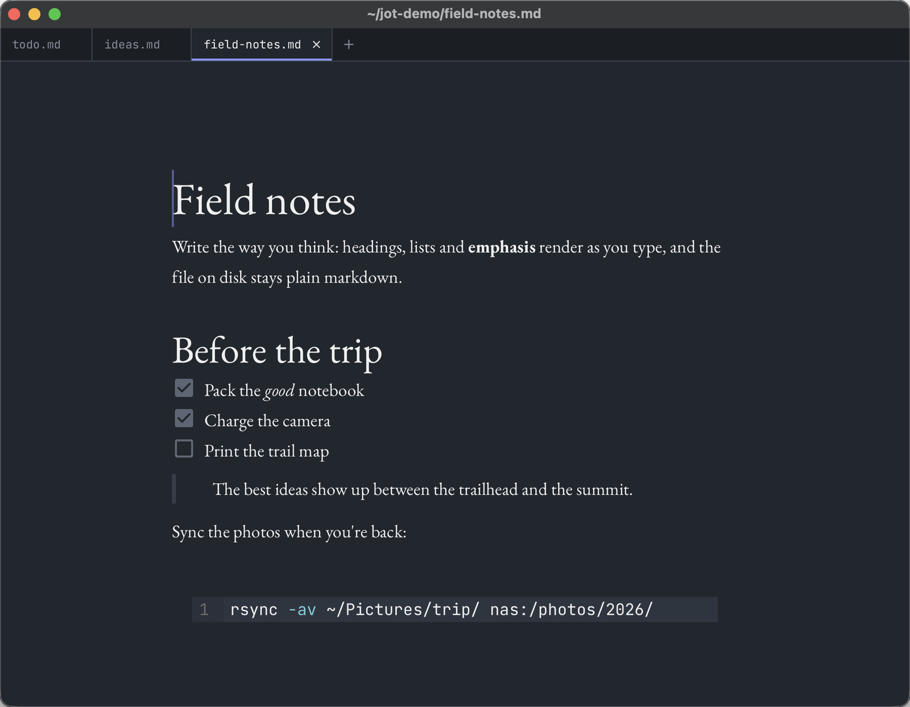
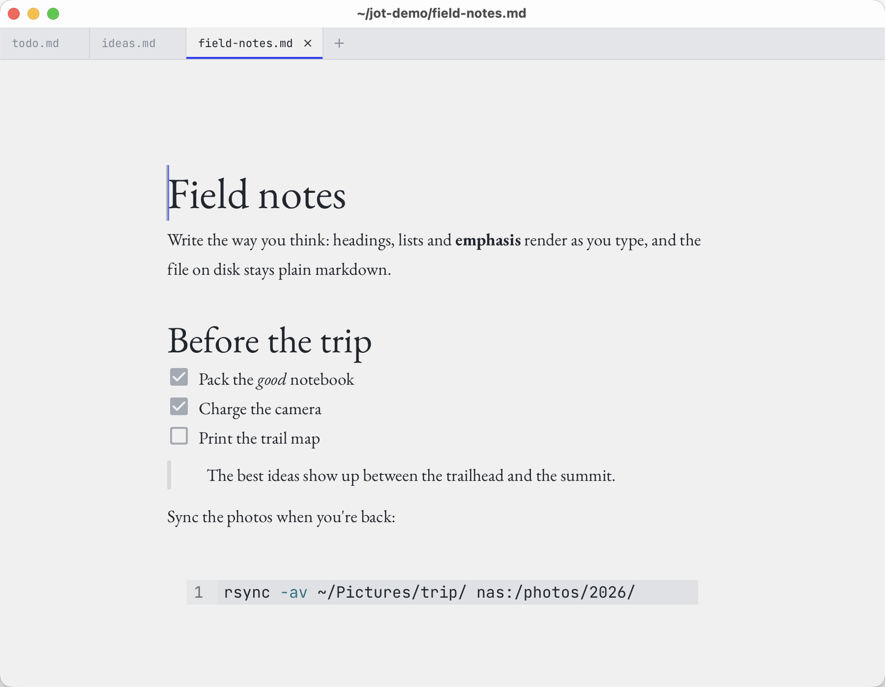

<figure class="fig" data-caption="Jot with a short note open."></figure>

I wanted a clean place to write that renders markdown as I type, without a sidebar full of features I'd never use. So Jot is just the page.

## Features

- Live markdown rendering
- Runs on macOS, Windows and Linux
- A few fonts and themes
- Text scaling and zoom
- Keyboard shortcuts for everything

## How it's built

It's a [Tauri](https://tauri.app) app, so it's small and native, with a Rust backend and a React frontend. The editor is built on Milkdown. You can grab a build from the [releases page](https://github.com/benshanahan1/jot/releases).
