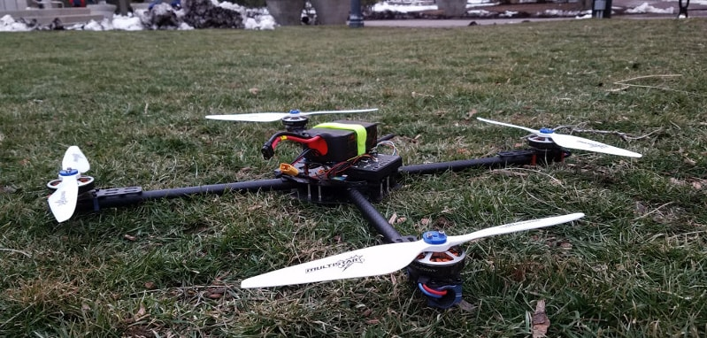
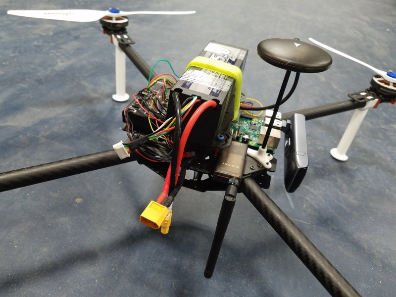

I worked on this with a team, and it started as a DIY project before turning into a much bigger effort over the semester. On top of building a drone that could carry packages up to 1 kg for 20 to 25 minutes, we had to write code that talked to the drone's onboard flight controller, a REST API, and an easy-to-use web app. To talk to the drone in flight, we gave it an LTE antenna and a SIM card for internet access.

I built the server back-end and the website. The back-end was a Python Flask app running on AWS. The database stored each drone's real-time position, velocity, altitude and battery voltage, and a separate process coordinated multiple drones, assigning deliveries based on how much battery each had left. The front-end had to work on phones and poll the server to show the drones' positions live on a map.

 we used on the first prototype.")

We met with the university's department of public safety several times to plan a live delivery demo. For safety, we had to fly over buildings as much as possible instead of point-to-point, so we added the ability to upload a waypoint path to each drone before takeoff. We ran out of time before we could hold the live demo, but we tested the full system several times in a safe area.

The full source is [here](https://github.com/IzzyBrand/dro.ne), and the latest version of my web app and server code is [here](https://github.com/benshanahan1/dronesvr). We also made a short teaser video for the demo:

<figure class="fig" data-caption="Lunadrop teaser video"><iframe src="https://www.youtube-nocookie.com/embed/Rt-q0L54g0c" title="Lunadrop teaser video" loading="lazy" allow="accelerometer; encrypted-media; gyroscope; picture-in-picture" allowfullscreen></iframe></figure>
