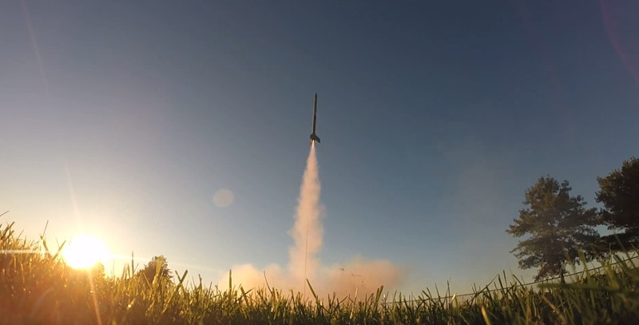
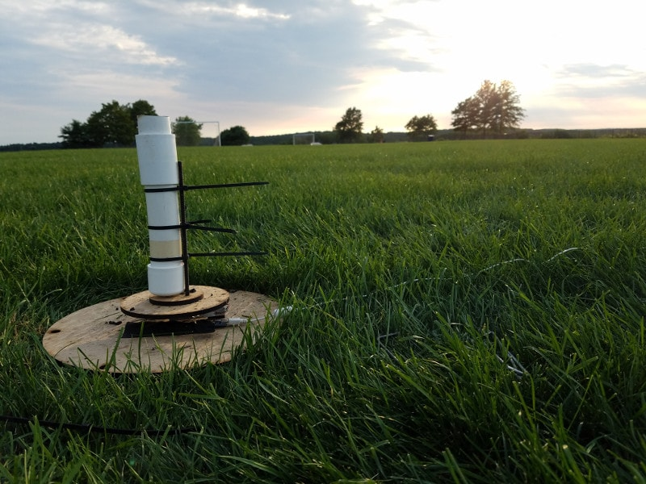
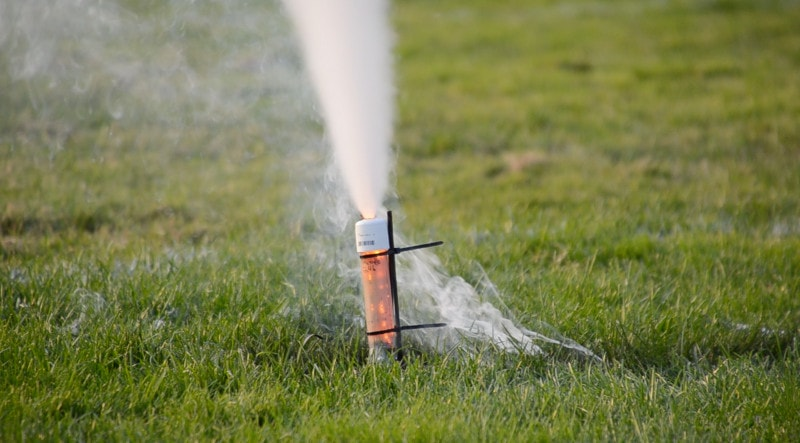

Implementing rocket control, automatic chute deployment, and real-time systems monitoring is a complex task, and ORI provides a codebase so open-source users can explore a real implementation of a real-time control system. The CAD designs for the rocket components (tube couplers, blast cap, nose cone, tail fins) are also available online. ORI had three parallel efforts:

- **Smart launchpad.** Trigger a launch over WiFi and measure motor thrust curves ([repo](https://github.com/openrocketryinitiative/launchpad))
- **Motors.** Optimize rocket motor thrust curves by adjusting fuel mixtures ([repo](https://github.com/openrocketryinitiative/motors))
- **Rocket flight computer.** Measure real-time rocket position and control chute deployment ([repo](https://github.com/openrocketryinitiative/carlson))

## Carlson, the flight computer

I led development of the rocket flight computer, lovingly nicknamed Carlson. Carlson runs on a Raspberry Pi Zero W and monitors the rocket's orientation in real time during flight. It has a 10-DOF MPU9255 inertial measurement unit with an accelerometer, gyroscope, magnetometer and barometer, and a telemetry radio lets us talk to the rocket while it's in the air. The ORI team flew Carlson on a bunch of launches, and the orientation data we collected let us build a real-time apogee detection algorithm.

 attach to the servo motors in the yellow housing.")

The algorithm first detects freefall (zero acceleration across all three axes) and then looks for more than 90 degrees of deviation from vertical. When both are true, meaning the rocket is falling back down, the Pi shorts a relay that heats some Nichrome wire, which ignites the blast cap and ejects the parachute. Here's a video of the [parachute being ejected](https://www.instagram.com/p/Bb0dSJujduq/).

In June 2018, as recipients of the NASA Rhode Island Space Grant, we gave a short talk at the RISG Symposium in Providence about Carlson, the smart launchpad and our motor testing. The [slides are on Google Slides](https://docs.google.com/presentation/d/1OxAxDKqtxr4odVjT6q38U2s4oX1R2K-lVKEJCeqgmxo/edit?usp=sharing), and there are more photos and videos on our [Instagram](https://www.instagram.com/openrocketryinitiative/).
