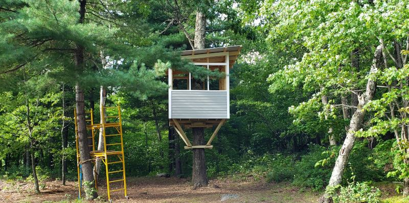
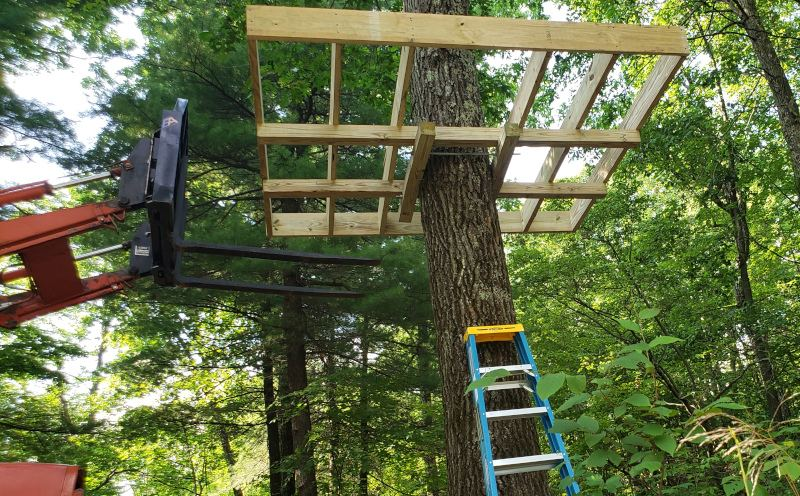
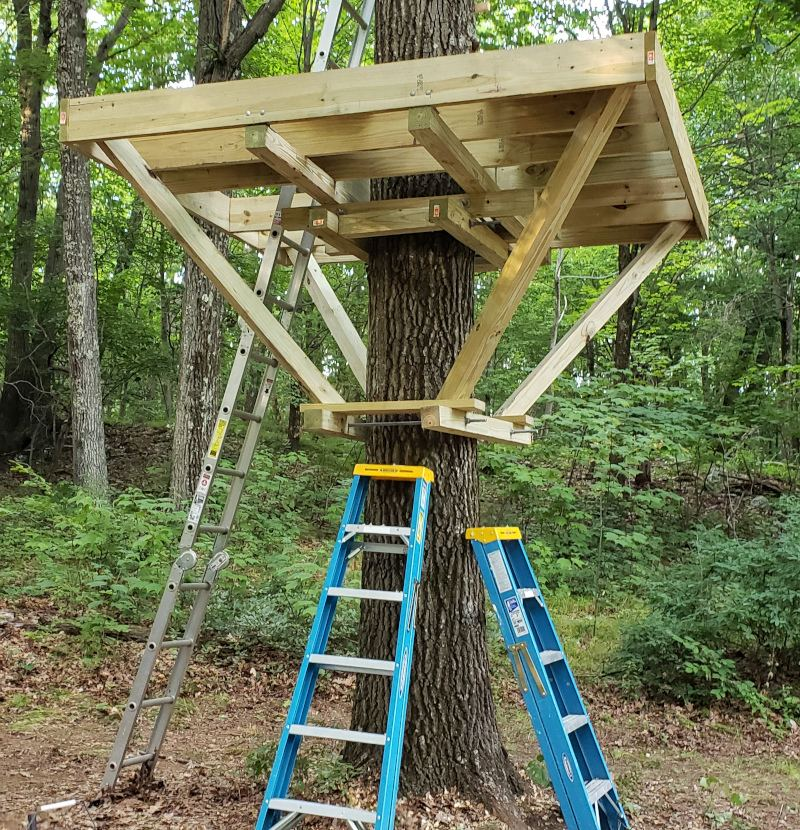
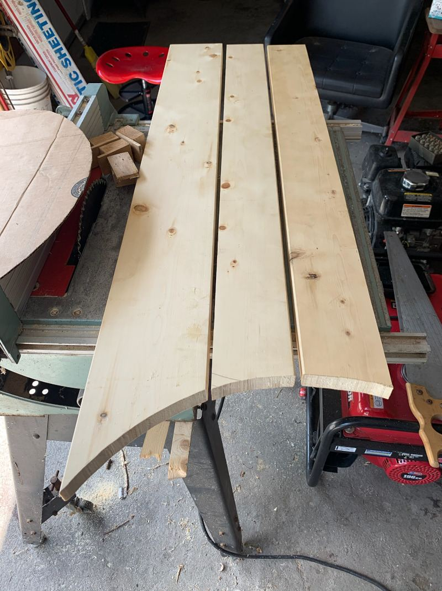
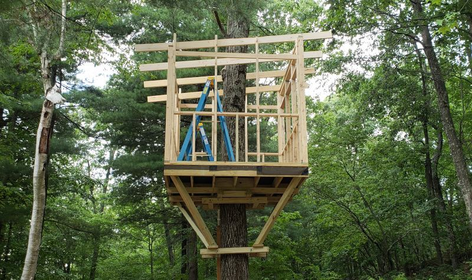
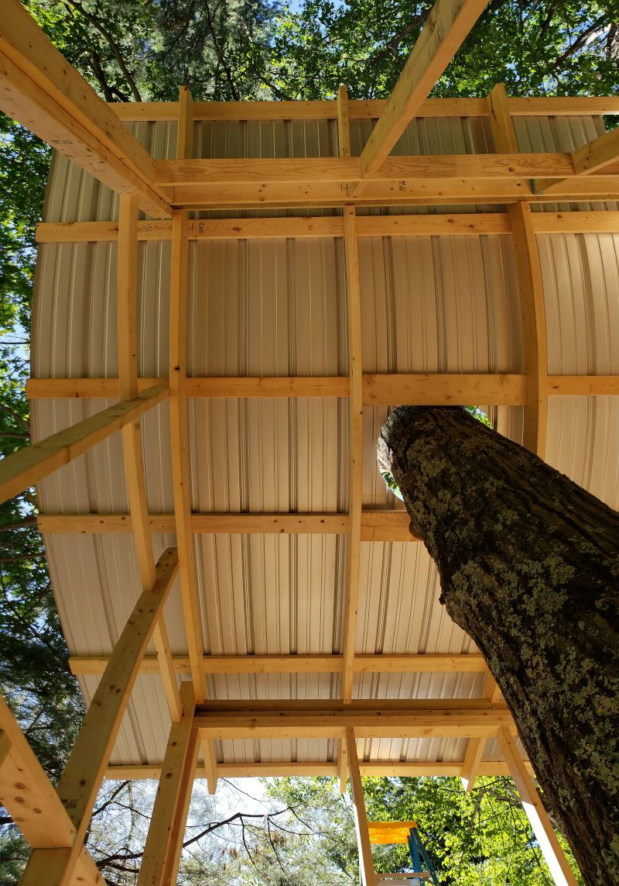
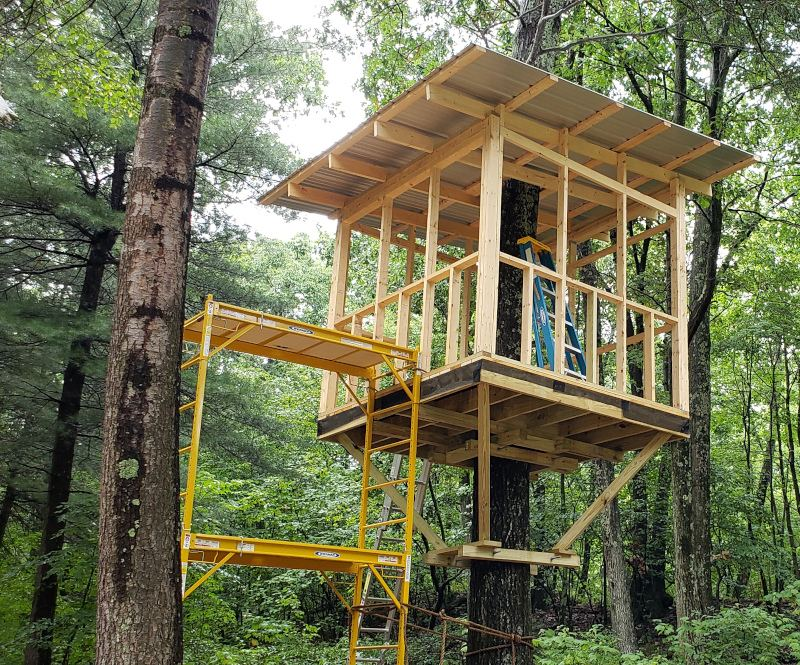
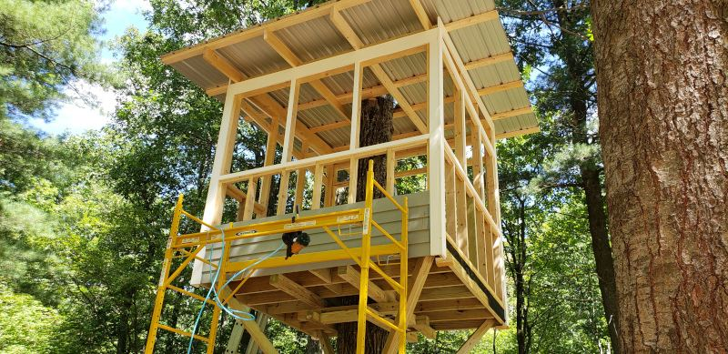
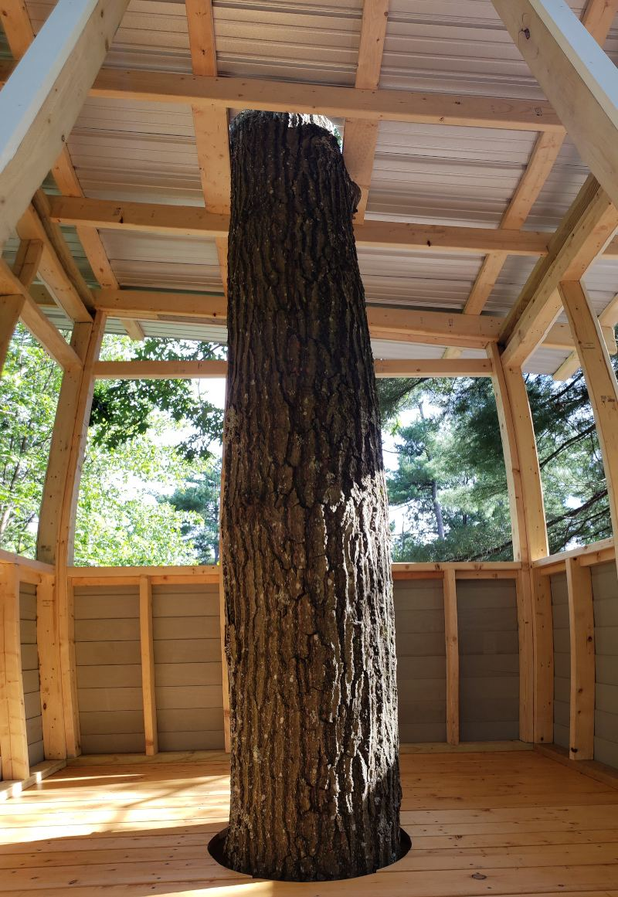
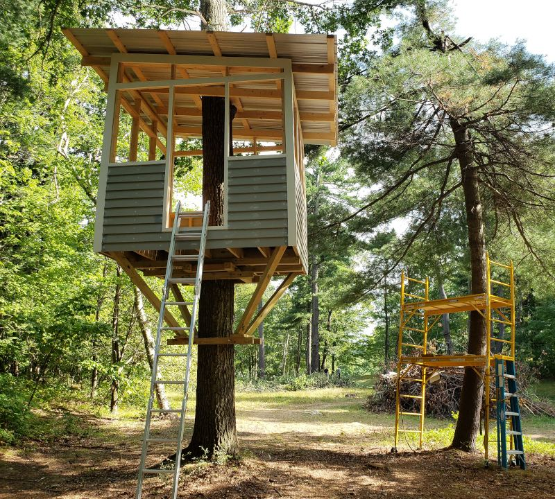

The first step (and arguably the most difficult) was to get the floor frame up in the tree. We built a clamp that would grip the tree trunk tightly, and after getting it level and tightened at around 10' up the trunk, we used a tractor and several ladders to gradually hoist the frame up and over. We detached two of the joists from the frame while lifting so that we could slide the assembly over the clamp.

To stabilize the frame, we added another clamp several feet below the frame and placed four 4x4 cantilever beams at 45° angles to transfer load from the frame corners to a central point lower down the tree.

The cedar deck boards needed to be cut so that they would evenly fit around the tree trunk. We used a system of string and cardboard to build a stencil and transfer the trunk's curvature directly to the cedar decking, which we then cut out with a handheld jigsaw.

We assembled the stud walls on the ground and then hoisted them up with a block-and-tackle pulley system. Using a portable compressed air tank and a nail gun, we immediately secured the stud walls into place on the frame once they were lifted up. We used four 2x6 beams as rafters to support the roof. These were notched so that they would sit on the tops of the stud walls and provide more stability.

On top of the rafters we secured purlins, which run perpendicular to the rafters and provide a surface to attach the roof. We chose a metal roof for longevity and strength, since debris constantly drops down from the tree canopy above. Similar to the decking, we used a stencil to transfer the tree's curvature onto the metal roof sheets so that we could make more accurate cuts.

After assembling the stud walls and roof, we used PVC boards as trim. We chose PVC since the trim is on the treehouse exterior and we wanted the structure to be as weather-resistant as possible. We covered the lower parts of the stud walls with clapboard siding and sealed everything with caulking. A 12' scaffold made it much easier to install the siding.

The (mostly) finished product. We still need to add screens and storm windows for summer and winter. The clapboard siding hasn't been painted yet (you can see the caulking over the siding nail holes).
