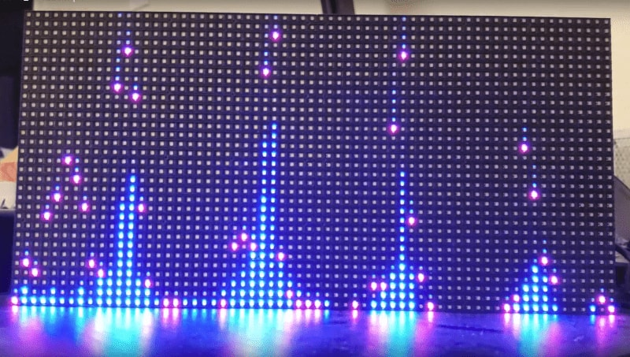

I built vmatrix to turn live audio into moving patterns on an RGB LED matrix. It runs in C on a Raspberry Pi 3 and reacts as the music changes.

The code is [on GitHub](https://github.com/benshanahan1/vmatrix), and here are some [pictures and videos](https://drive.google.com/drive/u/1/folders/1-5Ad2uvUaU7FSPwE7hDFrsoWIoqni-wP) of it in action!
